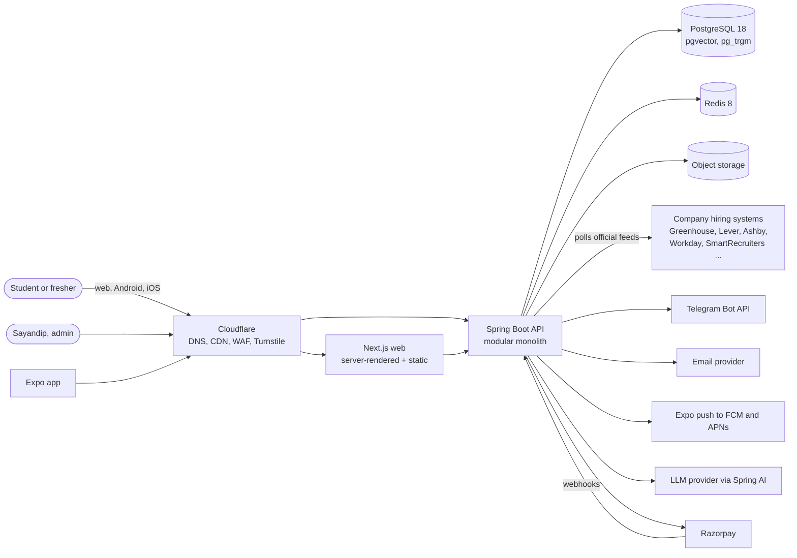

# Architecture

## Shape
A **modular monolith** (Spring Boot + Spring Modulith) behind Cloudflare, with PostgreSQL as the system of record, Redis for caches and rate limits, and two clients: web (Next.js) and mobile (Expo). Kafka-compatible streaming (Redpanda) and OpenSearch are planned extension points, added only when measurements demand them (ADR-0001, ADR-0002).

## System context

## Modules (Spring Modulith)
| Module | Owns | Publishes | Consumes |
|---|---|---|---|
| ingestion | connectors, schedules, raw payloads, normalisation, dedup | JobUpserted, JobClosed, SourceHealthChanged | - |
| catalog | companies, source registry, canonical jobs (read model) | - | JobUpserted, JobClosed |
| search | query API, ranking, filters, facets | - | catalog read model |
| identity | users, sign-in, sessions, tokens, roles | UserRegistered, UserDeleted | - |
| profile | preferences, encrypted resumes, fact bank | ProfileUpdated | UserDeleted |
| matching | match scores and explanations | MatchesComputed | JobUpserted, ProfileUpdated |
| tracker | applications kanban, notes, reminders | - | UserDeleted |
| alerts | saved searches, delivery (Telegram, push, email), dedup | AlertDelivered | JobUpserted, MatchesComputed |
| billing | plans, Razorpay subscriptions, webhooks, entitlements | EntitlementChanged | UserDeleted |
| tailoring | grounded resume tailoring, ATS check | - | profile and catalog APIs |
| trust | scam check, reports, moderation | JobFlagged | - |
| privacy | consents, export, deletion workflows, retention jobs | DataDeletionRequested | UserDeleted |
| audit | hash-chained audit log | - | security-relevant events |
| admin | internal operations API | - | everything (read) |
| shared | ids, time, errors, money: a tiny kernel | - | - |

Rules: modules talk through published APIs (named interfaces) or events, never through each other's tables. `ApplicationModules.verify()` runs in CI. Events go through Spring Modulith's event publication registry, a transactional outbox in PostgreSQL, so publishing and committing are atomic; moving events onto Redpanda later is configuration, not a rewrite.

## Main flows
**Ingestion to alerts**
1. db-scheduler fires a source's task (interval by tier and activity, with jitter).
2. The connector lists postings (conditional requests where supported) and fetches details for new or changed ones, under per-host rate limits and circuit breakers.
3. Normalise, classify, dedup, upsert the canonical job; store the raw payload (30-day retention).
4. Publish `JobUpserted` through the outbox. The search columns update in the same transaction; matching scores affected users in batches; alerts evaluate saved searches and enqueue deliveries with idempotency keys.
5. Delivery workers send Telegram, push and email messages with per-user rate limits and quiet hours.

**Read path (feed and search)**
Anonymous feeds and SEO pages are cached at the edge (short `s-maxage` with `stale-while-revalidate`). Signed-in feeds hit the API: Redis for common filter combinations, otherwise PostgreSQL full-text + trigram with keyset pagination.

**Payments**
Checkout on the web through Razorpay. Webhooks are verified by signature, stored by provider event id (unique) and processed idempotently; entitlements change in the same transaction; clients refresh entitlements on push or poll.

## Scaling path
| Stage | Trigger | Change |
|---|---|---|
| 1 (launch) | - | One server: k3s with the API (2 replicas), web (2 replicas), PostgreSQL and Redis; Cloudflare in front; Grafana Cloud for telemetry |
| 2 | Alert fan-out p95 over 60 s, or ingestion lag over its SLO | Redpanda for events and delivery queues; a separate worker deployment for ingestion and delivery |
| 3 | Search p95 over budget at target load, or features beyond PostgreSQL | OpenSearch for search; PostgreSQL stays the source of truth |
| 4 | Availability target 99.9% | A second node; a PostgreSQL streaming replica; read traffic split |
| 5 | Many users outside India | More edge caching; region-aware routing |

Moving between stages needs an ADR with the measurements that triggered it.

## Quality attributes
| Attribute | Target | How |
|---|---|---|
| Availability | 99.5% on one node; 99.9% from stage 4 | health probes, rolling deploys, stale-if-error at the edge, backups and drills |
| Latency | search p95 under 150 ms (Phase 1), under 100 ms at 500 rps (Phase 5) | indexes, keyset pagination, caching, virtual threads, pooled connections |
| Freshness | 95% of new tier-A postings searchable within 15 min | scheduling by tier and activity, conditional requests, priority queues |
| Resilience | one failing source never affects others | per-host bulkheads and circuit breakers, timeouts everywhere |
| Security | OWASP ASVS 5.0 level 2 | docs/engineering/SECURITY-PRIVACY.md |
| Cost | ₹0-1,500 a month for infrastructure in year 1 | one portable server, free tiers, caps on AI spend |
| Evolvability | a new source type in under a day | connector interface, fixture tests, `/new-connector` |

## Environments
| Env | Where | Data | Deploys |
|---|---|---|---|
| local | Docker Compose on Sayandip's PC | seed data and fixtures | on demand |
| staging | its own namespace on the server | synthetic data and a slice of real jobs | every merge to `main` |
| production | same cluster, own namespace and database | real | tagged releases, with approval |

## Contracts
The backend generates the OpenAPI spec; CI regenerates `packages/api-client` from it and fails on breaking changes, so web and mobile clients break at build time, not in production.
